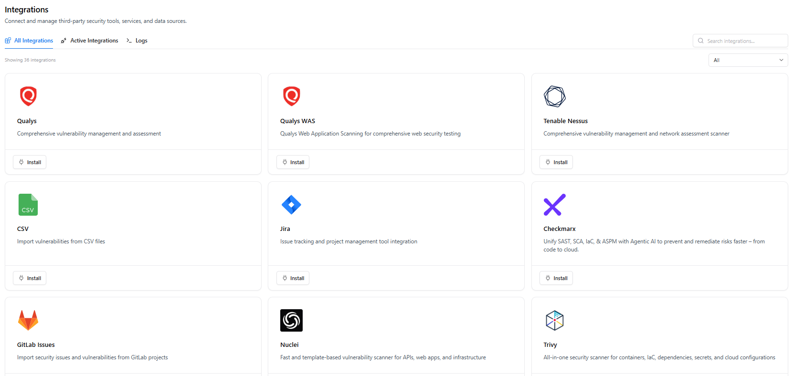
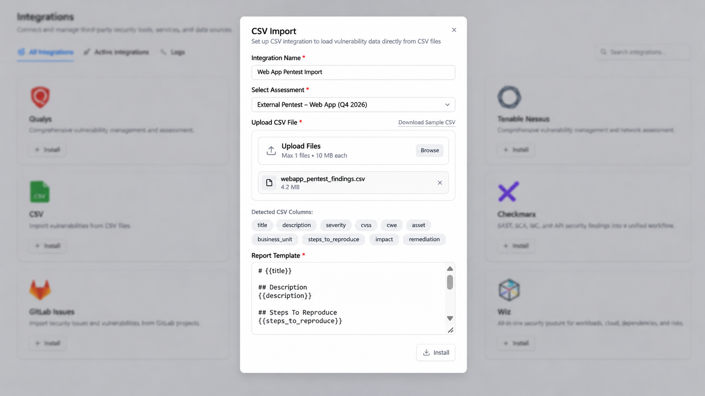
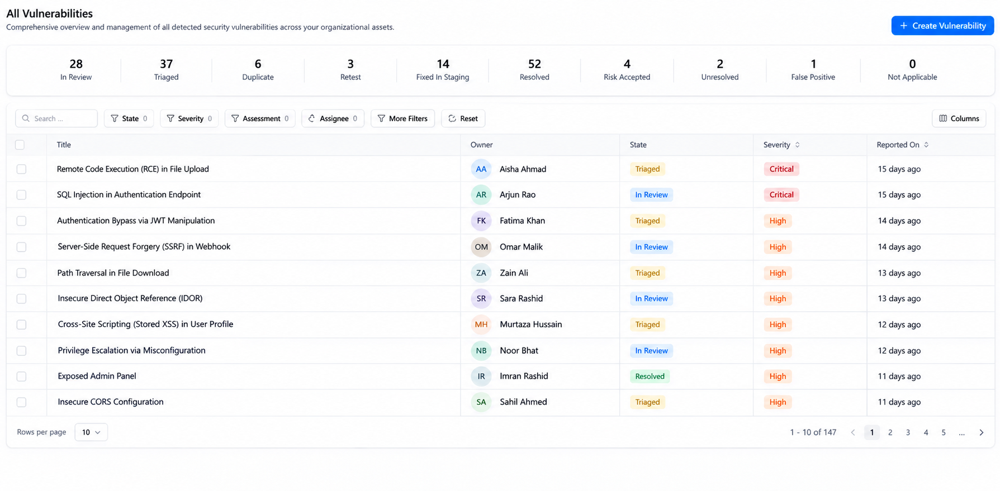
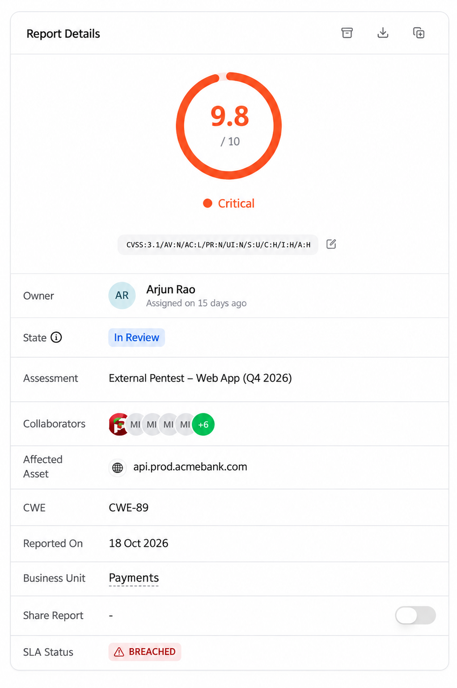

> **Key takeaways**
>
> - A pentest report is the one input to a vulnerability program that arrives as prose. Turning it into records is the first job, and it shapes everything after it.
> - Create the assessment before the report lands, so every finding has a home on day one.
> - Import findings as data, one row per finding, and keep the PDF as evidence.
> - Check severity, CWE, asset and business unit on arrival, and keep the tester’s original rating alongside your own.
> - Triage against what you already know before anyone opens a ticket. Duplicates close, and chained findings stay open.

Scanner output arrives as data. Each result has an asset identifier, usually a CVE or plugin ID and a timestamp, so it can be sorted, filtered and deduplicated before a person looks at it. A pentest report arrives as a document. The findings are prose, the severity is whatever scale the vendor prefers, and the affected system is described the way people describe it: “the customer API”, “the admin panel”.

That difference is why pentest findings so often end up outside the workflow the rest of the program uses. Someone copies the criticals into Jira, someone else builds a spreadsheet for the audit, and the PDF stays in a shared folder. Our earlier posts on [remediation after a pentest](/remediation-process/), [managing multiple pentests](/manage-pentests/) and [organizing audit evidence](/pentest-evidence/) all assume the findings are already inside one system. This post covers the step before that: getting them there.

## Why the report stays outside the workflow

Four mismatches explain most of it.

**Format.** A report is built to be read, not queried. You can’t filter a PDF by owner, and you can’t ask it which findings are still open.

**Severity.** One vendor rates Critical to Informational, another reports CVSS, and an internal red team writes narrative findings with no score. Until they’re recorded in one model, you can’t sort them together.

**Asset identity.** The report says `api.example.com`, or “the payments service”, or an IP range. If that doesn’t resolve to an asset your inventory knows about, nobody inherits ownership of the finding.

**State.** A report describes one moment in time. It has no concept of triaged, fixed, retested or accepted, and those states are what a workflow is made of.

## Start with the assessment, not the findings

Create the assessment before the report arrives. Give it a name, a category, dates, a business unit and a scope, and add the people involved. A new engagement starts at **New** and moves to **Testing Ongoing** while the testers work.

This isn’t paperwork. Every imported finding has to be attached to an assessment, and the assessment is what lets you later answer “what came out of this test?” with a filter instead of a search through email. It’s also where the scope document and rules of engagement belong, as we described in the evidence post.

## Get findings in as data

There are three ways findings enter Snapsec VM, and most programs use all of them.

- **CSV import** for pentest findings, one row per finding.
- **Integrations** for tool output. The Integrations page lists scanners, static analysis tools, cloud posture tools and ticketing systems, and findings from those sources land in the same list as everything else.
- **Manual creation** with the **Create Vulnerability** button, for the one-off finding from a code review, a bug bounty report or a conversation in the hallway.

*Scanners, code analysis tools and ticketing in one Integrations page. CSV import sits alongside them.*

For a pentest, CSV is the route that matters. Open **Integrations**, choose **CSV**, and the import dialog asks for four things: an integration name, the assessment the findings belong to, the CSV file, and a report template.

*The CSV Import dialog: one file up to 10 MB, a sample CSV to start from, and a report template.*

The report template is a markdown layout that uses `{{placeholders}}` named after your column headers, such as `{{title}}`, `{{description}}` and `{{steps_to_reproduce}}`. Each row becomes one vulnerability, and the template builds its report body.

Two habits make this go smoothly.

**Send the vendor the sample CSV before testing starts.** The dialog has a **Download Sample CSV** link. Put that column layout in the statement of work, so the findings table comes back in the format you can import. Asking after the report has been written is much harder, because the vendor then has to reformat their own deliverable.

**Build the template for the developer who will fix the finding.** Because the template produces the report body, it only shows what you reference. A template with just description and steps to reproduce will drop the impact and the remediation advice from what the developer reads. Add sections for both.

If the vendor only sends a PDF, build the CSV yourself, one row per finding, and attach the PDF to the assessment under **Docs & Evidences**. The PDF is still the signed record of the engagement. It just shouldn’t be the thing your team works from.

## Check the fields that drive everything after import

Open one imported finding and look at the **Report Details** panel. These are the fields that determine how the finding behaves for the rest of its life.

*Severity and CVSS vector, owner, state, assessment, asset, CWE and SLA status in one panel.*

**Severity and vector.** Keep the tester’s CVSS vector, because the vector is the argument and the number is only its summary. For the SQL injection finding shown here, use `CVSS:3.1/AV:N/AC:L/PR:N/UI:N/S:U/C:H/I:H/A:H`. It describes a network-reachable flaw that requires no privileges or user interaction, with high potential impact on confidentiality, integrity and availability. Under CVSS 3.1, this vector scores **9.8 (Critical)**. A score of 9.5 would also fall in the Critical band, not High. If a vendor’s score doesn’t match their own vector, ask about it before the finding is prioritized.

**CWE.** This is what lets you group findings across engagements later. A finding imported without one can’t join a pattern. Fill it in at intake, because nobody goes back to do it.

**Affected asset.** Match it to an asset in the catalog. That link is what lets the finding pick up an owner and a business context instead of depending on whoever read the report.

**Business unit.** Set it. An empty business unit means business context can’t influence prioritization for that finding, and a pentest finding with no context sorts by severity alone, which is the problem we’re trying to avoid.

**The SLA clock.** Decide which date starts it. A report delivered on the 3rd and imported on the 24th shouldn’t quietly give the owner three weeks they were never meant to have. Agree on the rule once, and apply it to every import.

## Triage against what you already know

Imported findings aren’t work yet. Treat everything as **In Review** until someone has confirmed it, because some of it will duplicate what your scanners already found.

*One list for every source, with a count per state and filters for state, severity, assessment and assignee.*

The state counters across the top of **All Vulnerabilities** make the goal visible: In Review, Triaged, Duplicate, Retest, Fixed in Staging, Resolved, Risk Accepted, Unresolved, False Positive and Not Applicable. A finding should always be in exactly one of them, and nothing should sit in In Review for long.

For each imported finding, use the search and the **Assessment** filter to check whether the same weakness is already recorded on the same asset. Then one of three things is true.

**It’s a duplicate.** Close one of the two as **Duplicate** and point it at the other. We keep whichever record carries the proof of concept, which is almost always the pentest finding, and close the scanner entry.

**It’s a chain, not a duplicate.** This is the case that’s easy to get wrong. A scanner reports a Medium open redirect and, separately, a Medium permissive CORS policy. A tester chains the two into account takeover and reports the combined attack path as Critical. The scanner findings aren’t duplicates of the pentest finding. They’re ingredients in it. Keep both, and link them in a comment, so that fixing either one is understood to break the chain.

**It’s not applicable.** The asset was decommissioned last quarter, or the component isn’t deployed. Close it as **Not Applicable** with a note.

Do this triage while the testers are still reachable. A question about a reproduction step is a five-minute conversation in the first week and a guessing game three months later.

## Hand findings to the people who fix them

Confirmed findings need an owner. Assign through the asset or business unit so the finding follows the system rather than the person who received the report, and use the **Assignee** filter to check that nothing is left unowned.

Then connect the work to the tool engineers already live in. Snapsec VM has a Jira integration on the Integrations page, so the tracker your developers already use stays part of the workflow. Set it up before the first import, and decide up front which system is the source of truth for state: the finding or the ticket. Two places that both claim to know whether something is fixed will eventually disagree.

One practical point: group before you ticket. Findings that share a fix, such as the same outdated library or the same authorization logic copied across controllers, should become one piece of work, not twelve tickets. The [remediation post](/remediation-process/) covers how campaigns handle this.

## Example: a 28-finding report

A vendor delivers a web application test with 28 findings (illustrative numbers). The security team had created the assessment two weeks earlier.

On day one, the vendor’s findings table is imported as CSV, and all 28 land In Review. The PDF goes into Docs & Evidences.

On day two, with the testers on a call, the team triages. Three findings describe issues the scanners had already reported on the same hosts. The pentest records carry the proof of concept, so the scanner entries are closed as Duplicate and point to them. One finding sits on a host that was retired in September, so it’s closed as Not Applicable. Two scanner Mediums that had been open for months turn out to be the first two links of a chain the testers used to reach admin access. They stay open, linked to the pentest finding.

The 27 applicable findings go to three owners through the assets they affect. Related findings are grouped, and the work becomes 19 Jira tickets.

By the end of the second day, every finding has a state, an owner and a ticket, and the report is attached as evidence. Without the import, the same report would still be a PDF in a shared folder.

## Pentest intake checklist

| Step | What to do | Where in Snapsec VM |
|---|---|---|
| Create the assessment | Name, category, dates, scope, business unit | Assessments |
| Agree the format | Send the vendor the sample CSV before testing | Integrations, CSV |
| Import | One row per finding, template includes impact and remediation | Integrations, CSV |
| Attach the report | Keep the PDF as evidence | Assessment, Docs & Evidences |
| Verify fields | CVSS vector, CWE, asset, business unit, SLA start | Finding, Report Details |
| Triage | Close duplicates and Not Applicable, link chains | All Vulnerabilities |
| Assign | Owner through the asset or business unit | All Vulnerabilities, Assignee |
| Ticket | Group by fix, then create tickets in your tracker | Integrations, Jira |

## Conclusion

A pentest finds problems at one moment. Whether those problems get fixed depends on how quickly they stop being a document and become records with a state, an owner and a ticket. The faster that happens, the more of the testers’ work is still useful when it does.

Snapsec VM is built to make that conversion short. Pentest findings come in through CSV import, scanner and code analysis results arrive through integrations, and everything lands in one list with the same states, owners and SLA tracking. [**Explore the live demo**](https://suite.snapsec.co/demo) to see it, or read more about [vulnerabilities](https://docs.snapsec.co/products/vm/vulnerabilities) and [VM integrations](https://docs.snapsec.co/integrations/vm/index) in the Snapsec docs.

## Frequently asked questions

**Can I import the PDF report itself?**

Import works on rows of data, so the findings need to arrive as a CSV. Keep the PDF with the assessment under Docs & Evidences, where it serves as the signed record of the engagement.

**What if the vendor will only send a PDF or a Word document?**

Build the CSV yourself, one row per finding, using the sample CSV for the column names. It’s tedious once, and it’s a good reason to put the findings format in the next statement of work.

**Whose severity wins when the pentest and the scanner disagree?**

Neither one on its own. Record both. The tester’s rating reflects what was actually exploited in your environment, and the scanner’s reflects a signature. Prioritize using your own context, such as exposure, asset type and business unit, instead of picking a number.

**Who should do the triage, and when?**

The security team, in the first few days after delivery, while the testers can still answer questions and schedule retests. Findings left in In Review for weeks are the ones that tend to disappear.

**Should every confirmed finding become its own ticket?**

No. Group findings that share a fix first, then create one ticket per piece of work.
